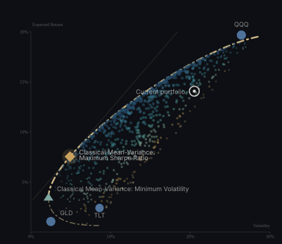
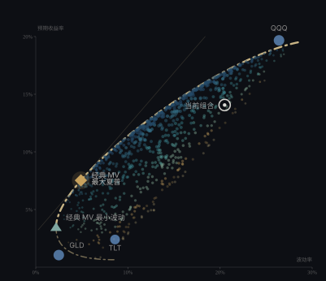
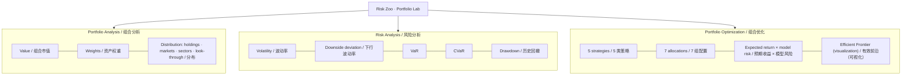
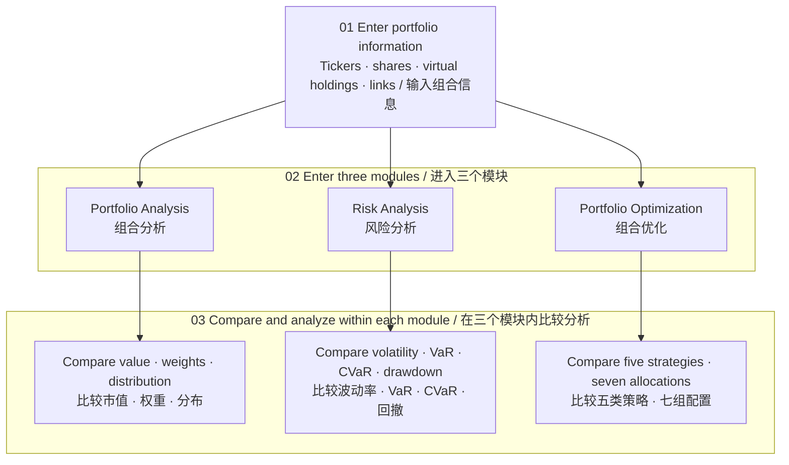
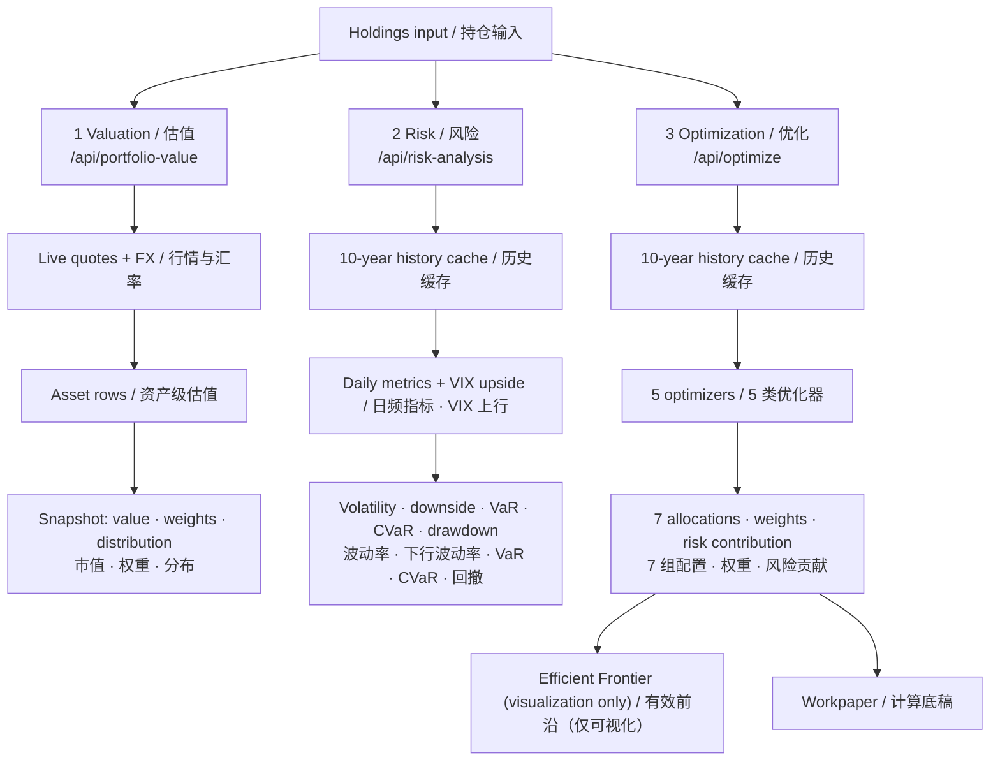

# Risk Zoo

A portfolio holdings management and risk analytics system. / 投资组合持仓管理与风险分析系统。

   

## Live Demo / 在线入口

- **Project site**: https://risk-zoo.pages.dev/ · This repository's GitHub Pages URL is a redirect page to the project site.
- **项目主页**：https://risk-zoo.pages.dev/
- 本仓库的 GitHub Pages 地址 https://bnycx.github.io/risk-zoo/ 是跳转页，访问后直接进入上面的项目主页。

## Overview / 项目概览

**English** — Risk Zoo · Portfolio Lab · **Portfolio Analytics & Optimization**. Analyze portfolios. Understand risks. Compare strategies. See how a portfolio is structured, which holdings show greater downside and tail risk, and how different optimization methods reshape the allocation.

**中文** — Risk Zoo · Portfolio Lab · **投资组合分析与优化**。分析投资组合，理解各类风险，比较配置策略。了解组合如何构成、哪些持仓表现出更高的下行与尾部风险，以及不同优化方法如何改变资产配置。

## At a Glance / 一眼看懂

| English | 中文 |
|---|---|
| 3 Analytical Views | 3 个分析视角 |
| 10 Risk Dimensions | 10 项风险维度 |
| 5 Optimization Strategies | 5 类优化策略 |
| 7 Candidate Allocations | 7 组候选配置 |
| Up to 10 Years of History | 最长 10 年历史数据 |

> Terminology: five formal optimizers — Classic MV, Factor MV, NCO, Risk Parity, HRP. "7" denotes seven candidate allocations (seven optimizer run entries in the workpaper); it does not denote a seven-optimizer set. The efficient frontier is a visualization, not an additional optimizer category.
> 口径：5 类正式优化器为 Classic MV、Factor MV、NCO、Risk Parity、HRP；「7」指 7 组候选配置（计算底稿含 7 个 optimizer run entries），并非七类优化器；有效前沿属于可视化结果，不是一类独立的优化方法。

## Efficient Frontier (Illustrative) / 有效前沿示意图

| English (illustrative, not live market data) | 中文（示意图，非实时市场数据） |
|---|---|
|  |  |

> Figure 1：Illustrative risk–return space: volatility on the horizontal axis, expected return on the vertical axis, both indicative. Shows candidate portfolios, the efficient frontier, the inefficient boundary, the maximum Sharpe portfolio, and the current portfolio. **Schematic illustration, not a live market calculation.** Exported from the project's landing-page rendering logic, not redrawn.
> 图 1：组合风险收益空间示意——横轴为波动率、纵轴为预期收益率，两者均为示意表达；图中含候选组合散点、有效前沿、低效边界、最大夏普组合与当前组合。**示意图，非实时市场数据**。图片从项目欢迎页的渲染逻辑同源导出，未重新绘制。

## Core Capabilities / 三大能力

| English | 中文 |
|---|---|
| **Portfolio Analysis** — Review portfolio value, asset weights, and distribution across holdings, listing markets, sectors, and look-through exposures. | **组合分析** — 查看组合市值、资产权重，以及按持仓、上市市场、行业和穿透标的呈现的资产分布。 |
| **Risk Analysis** — Compare volatility, downside deviation, VaR, CVaR, and historical drawdowns across individual assets. | **风险分析** — 比较各项资产的波动率、下行波动率、VaR、CVaR 和历史回撤。 |
| **Portfolio Optimization** — Compare five optimization strategies and seven candidate allocations by expected return and model risk. | **组合优化** — 从预期收益与模型风险两个维度，比较五类优化策略生成的七组候选配置。 |

> Figure 2：Capability map; terminology follows the source project's `docs/`. / 图 2：三大能力地图。口径以原项目 `docs/` 为准。

## Get Started in Three Steps / 三步上手

| Step / 步骤 | English | 中文 |
|---|---|---|
| 01 | **Enter Holdings** — Enter tickers, shares, virtual holdings, and representative-asset links. | **输入持仓** — 输入证券代码、股数、虚拟持仓和代理关系。 |
| 02 | **Run the Analysis** — Review portfolio value, asset-level risk, and candidate allocations. | **运行分析** — 查看组合市值、单项资产风险和候选配置。 |
| 03 | **Compare Results** — Compare asset distribution, risk measures, and optimization strategies. | **比较结果** — 比较资产分布、风险指标和优化策略。 |

The landing page offers three entry points: **Analyze My Portfolio** and **Enter my holdings** lead to the holdings input; **View Sample Portfolio** opens pre-filled example results.

欢迎页的三个入口：**分析我的组合 / Analyze My Portfolio** 与 **开始配置组合 / Enter my holdings** 进入持仓输入区；**查看示例组合 / View Sample Portfolio** 打开已预填的示例分析结果。

> Figure 3：1 → 3 → 3 flow: enter portfolio information, open the three modules, then compare within each. / 图 3：1-3-3 结构——输入组合信息、进入三个模块、在模块内比较分析。

## Features & Data Flow / 功能与数据流

| English | 中文 |
|---|---|
| Holdings — enter and save positions (persisted for signed-in users; sample state for guests) | 持仓管理 — 录入与保存持仓（登录用户持久化，游客为示例状态） |
| Current valuation — market value and distribution from live quotes and FX rates | 当前估值 — 按真实行情与汇率计算持仓市值与分布 |
| Risk analysis — daily risk metrics and VIX upside scenarios from the 10-year history cache | 风险分析 — 基于 10 年历史缓存的日频风险指标与 VIX 上行冲击 |
| Optimization — optimizer results, weights, risk contribution, and efficient frontier | 组合优化 — 多优化器结果、权重表、风险贡献与有效前沿 |
| Workpaper — previewable, copyable, downloadable, and recoverable after refresh | 计算底稿 — 可预览、复制、下载，刷新后可恢复 |
| NAV history — portfolio value curve for signed-in users | 历史净值 — 登录用户的组合总市值曲线 |
| AI Q&A — ask questions about the current results | AI 提问 — 针对当前结果提问 |
| Admin console — separate read-only operations dashboard | 管理员后台 — 独立入口，只读运营摘要 |

After holdings are entered, the three modules run as **independent, parallel paths** with their own endpoints, triggers, and outputs — not as a serial chain.

输入持仓后，三个模块是**并列的三条独立路径**，各有自己的端点、触发按钮与输出，不是串行链。

> Figure 4：Three parallel data paths — valuation, risk, optimization from left to right — each with its own endpoint and trigger; the efficient frontier is a visualization produced by optimization, not a separate optimizer. / 图 4：三条并列数据流，从左到右依次为估值、风险、优化，各有独立端点与触发；有效前沿是优化产生的可视化，不是独立优化器。

## About This Repository / 关于本仓库

**English** — This repository contains only a redirect page and **no source code**. The source, configuration, data, and formal development documentation live in [portfolio-web](https://github.com/bnycx/portfolio-web), with `docs/README.md` as the documentation entry point. Authoritative terminology and contracts follow the source project's `docs/`; the project overview follows its `README.md`. This repository does not maintain a parallel documentation system.

**中文** — 本仓库只保留一个跳转页，**不包含源码**。原项目的源码、配置、数据与正式开发文档均在 [portfolio-web](https://github.com/bnycx/portfolio-web)；正式开发文档入口为该仓库的 `docs/README.md`。对外口径与正式契约以原项目 `docs/` 为准；项目概览以原项目 `README.md` 为准。本仓库不做第二套文档体系。

## Disclaimer / 免责声明

**English** — For reference only. Quotes and FX rates come from external sources and may be delayed or unavailable due to caching or upstream limits. Guests see a sample state, not real results of any account, and nothing here constitutes investment advice. All charts are schematic illustrations, not live market data.

**中文** — 仅供参考。行情与汇率来自外部数据源，可能因缓存或上游限制出现延迟或缺失。游客看到的是示例状态，不是任何账户的真实结果，也不构成投资建议。所有图表均为示意图，非实时市场数据。

---

*Risk Zoo · Portfolio Lab — For reference only / 仅供参考*
